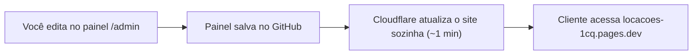

# 📸 Locações — Galeria de espaços para fotografar

Site elegante (preto e dourado) para apresentar locações a clientes, com **painel no navegador** para editar fotos, vídeos, textos e cores.

**100% gratuito:**

| Peça | Serviço (grátis) | Função |
|---|---|---|
| Hospedagem | **Cloudflare Pages** | Site sempre no ar e sem limite de visitas. Endereço `locacoes-1cq.pages.dev` |
| Painel | **Sveltia CMS** (open source) | Editar tudo em `seusite/admin` |
| Armazenamento | **GitHub** (repositório privado) | Guarda o projeto e o histórico de alterações |

O cliente só **visualiza**. Só quem tem a chave de acesso consegue editar.

---

## 🧭 Como funciona



---

## 🚀 Configuração inicial (só uma vez)

### 1. Publicar na Cloudflare
1. Crie uma conta grátis em https://dash.cloudflare.com/sign-up
2. No menu, vá em **Workers e Pages** → **Criar** → aba **Pages** → **Conectar ao Git**.
3. Autorize o GitHub e escolha o repositório **locacoes**.
4. Preencha:
   - **Nome do projeto:** `locacoes` (vira `locacoes-1cq.pages.dev`; se estiver ocupado, escolha outro)
   - **Predefinição de framework:** `Nenhum`
   - **Comando de build:** `node scripts/build.mjs`
   - **Diretório de saída do build:** `dist`
5. Clique em **Salvar e implantar**. Em 1–2 minutos o site está no ar.

> Se o nome escolhido for diferente de `locacoes`, troque `locacoes-1cq.pages.dev` pelo seu endereço nas linhas `site_url` e `display_url` de [`admin/config.yml`](admin/config.yml).

### 2. Desligar o GitHub Pages e deixar o projeto privado
- GitHub → repositório → **Settings → Pages** → em *Source* escolha **None** (ou "Unpublish").
- **Settings → General → Danger Zone → Change visibility → Private**.

### 3. Ativar o login com GitHub (uma vez só, ~3 min)
Assim você entra no painel com sua conta do GitHub, sem token que expira.

**a) Criar o "app de login" no GitHub**
1. Abra https://github.com/settings/applications/new
2. Preencha:
   - **Application name:** `Painel Locações`
   - **Homepage URL:** `https://locacoes-1cq.pages.dev`
   - **Authorization callback URL:** `https://locacoes-1cq.pages.dev/api/callback`
3. Clique em **Register application**.
4. Copie o **Client ID**. Depois clique em **Generate a new client secret** e copie o **segredo**, que só aparece uma vez.

**b) Colocar os códigos na Cloudflare**
1. Cloudflare → seu projeto → **Configurações** → **Variáveis e segredos** → **Adicionar**.
2. Crie a variável `GITHUB_CLIENT_ID` com o Client ID (tipo: Texto).
3. Crie a variável `GITHUB_CLIENT_SECRET` com o segredo (tipo: **Segredo**).
4. Salve. Depois vá em **Implantações** e, na implantação mais recente, clique em **⋯ → Tentar novamente**, para aplicar as variáveis.

**c) Entrar**
Abra `https://locacoes-1cq.pages.dev/admin` e clique em **Sign In with GitHub**. Em qualquer computador ou celular, é só entrar com sua conta do GitHub.

> O acesso não expira. Para revogar: GitHub → Settings → Applications → Authorized OAuth Apps.
> Alternativa: **Sign In with Token** continua disponível, caso o login com GitHub esteja indisponível.

---

## ✏️ Usando o painel (`/admin`)

### Locações
- **Nova locação**: botão **New** (Novo). Depois preencha nome, cidade, capa, fotos e infos e clique em **Save** (Salvar).
- **Fotos**: no campo *Fotos da galeria*, selecione **várias de uma vez**. Elas são **convertidas para WebP e reduzidas automaticamente** (carregam rápido). Arraste para mudar a ordem.
- **Vídeos**: cole um **link** (YouTube "Não listado", Vimeo ou Google Drive) **ou** envie um **arquivo MP4 de até 20 MB**. Para vídeo gravado em pé no celular, marque *Vídeo em pé*.
- **Esconder** sem apagar: desligue *Visível no site*.
- **Ordem** na página: campo *Ordem* (10, 20, 30… menores primeiro).

### Configurações
Em **Configurações → Aparência, textos e contato**:

| Seção | O que muda |
|---|---|
| Marca | Nome, slogan, logo |
| Cores | Todas as cores (seletor visual) |
| Fontes | Fonte dos títulos e do texto (lista pronta), tamanho, caixa alta |
| Textos | Todos os textos do site |
| Layout | Fotos por linha, formato da foto, bordas, posição do nome, infos no cartão, ordem das seções |
| Contato | WhatsApp (com mensagem automática), Instagram, e-mail |
| Proteção | Bloqueio de clique direito/arrastar nas fotos |
| Privacidade | Ocultar o site do Google |

Depois de salvar, o site se atualiza sozinho em cerca de 1 minuto.

### Paletas douradas prontas (cole no seletor de cor)
| Estilo | Principal | Claro | Escuro |
|---|---|---|---|
| Clássico (padrão) | `#c9a45c` | `#ead7a4` | `#8c6a2f` |
| Champagne | `#d4b98c` | `#f1e4c8` | `#9a7f55` |
| Ouro intenso | `#d4af37` | `#f5e08a` | `#8f7320` |
| Ouro rosé | `#c8977a` | `#ecc9b4` | `#8a5f48` |

---

## 📁 Estrutura do projeto

```
Locações/
├── index.html / local.html   ← páginas do site
├── admin/
│   ├── index.html            ← painel
│   └── config.yml            ← campos do painel
├── content/                  ← 📝 CONTEÚDO (editado pelo painel)
│   ├── site.json             ← cores, fontes, textos, contato
│   └── locacoes/*.json       ← uma locação por arquivo
├── assets/
│   ├── uploads/              ← fotos e vídeos enviados pelo painel
│   └── img/                  ← favicon
├── scripts/build.mjs         ← monta o site (roda na Cloudflare)
├── css/ js/                  ← visual e funcionamento
└── (gerados, não editar) config/site.js, data/locacoes.js, dist/
```

### Ver no computador (opcional)
Precisa do [Node.js](https://nodejs.org) instalado:
```bash
git pull                 # baixa o que foi editado pelo painel
node scripts/build.mjs   # gera os arquivos
```
Depois abra o `index.html`.

---

## 📏 Limites do plano grátis

| Item | Limite | Na prática |
|---|---|---|
| Visitas | Ilimitadas | ✅ |
| Atualizações do site | 500 por mês | Cada "Salvar" no painel conta 1 |
| Tamanho por arquivo | 25 MB | Por isso vídeos até 20 MB. Maiores vão pelo YouTube |
| Quantidade de arquivos | 20.000 | Milhares de fotos |
| Repositório GitHub | ~1 GB recomendado | Fotos em WebP têm ~300 KB, ou seja, ~3.000 fotos |

---

## 🔒 Segurança

- **Painel protegido**: só entra quem tem um token com permissão de escrita no repositório (só você).
- **Site estático**: o cliente não tem como alterar nada. Não existe banco de dados nem formulário.
- **Content-Security-Policy** e cabeçalhos de segurança (anti-iframe, anti-sniffing, HTTPS forçado).
- Todo texto é inserido de forma segura. Links `javascript:` são bloqueados.
- **Ocultar do Google** (ligado por padrão): só acessa quem tem o link.
- **Histórico completo**: toda alteração fica salva no GitHub e pode ser desfeita.
- Proteção das fotos dificulta copiar, mas nenhum site impede 100% (print de tela sempre funciona).

---

## 🌐 Domínio próprio (opcional, ~R$40/ano)
1. Compre em https://registro.br (ex: `seunome.com.br`).
2. Cloudflare → seu projeto Pages → **Domínios personalizados** → **Configurar domínio** e siga as instruções.
3. Atualize `site_url` em `admin/config.yml`.
